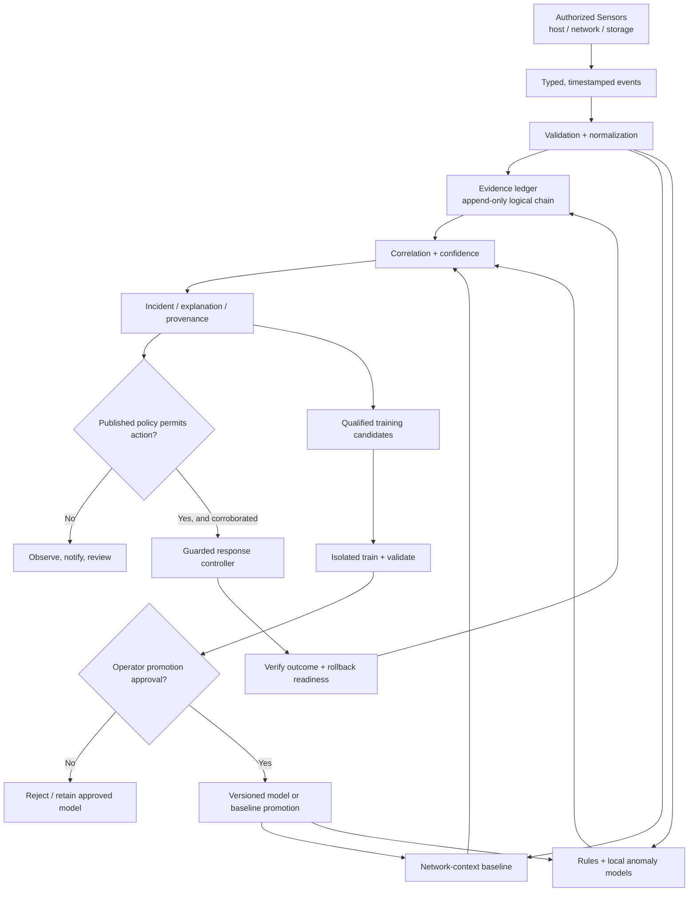

<!-- BEACON COMPUTING INITIATIVE | Developer Seal: CJB-DEV-2026 -->
# ORBIT11 | Adaptive Cyber Defense, Built for Evidence

**BEACON COMPUTING INITIATIVE** | **Developer Seal: CJB-DEV-2026**  
**ORBIT11 / BCI Orbital Cyber Defense AI** | **Status: Documentation-first / implementation not yet imported**

> **Observe accurately. Preserve faithfully. Analyze transparently. Communicate securely. Act deliberately.**

**ORBIT11** is the Beacon Computing Initiative's next-generation host and network cyber-defense project. Its goal is to give a human operator a trustworthy, context-aware picture of what a system is doing, identify meaningful behavioral deviations, preserve defensible evidence, and respond to corroborated threats under an explicitly approved policy.

The design combines defensible telemetry collection, adaptive baselines, deterministic security controls, and a bounded AI analysis layer. The intended environment is a Linux workstation or server, beginning with Kali Linux. Production enforcement is not enabled by this repository.

| Project | Current state |
|:--|:--|
| Repository | Private, documentation-first |
| Runtime | **Not implemented in this repository** |
| AI models | Architecture and acceptance criteria defined; **no trained model included** |
| Collectors | Proposed; no collectors deployed from this repository |
| Containment | **Not implemented or armed** |
| Testing | Test strategy specified; no product test suite committed |
| Deployment | **HOLD** pending implementation, tests and approval |
| Developer seal | `CJB-DEV-2026` |

**Important:** Prior BCI Orbital experiments and any currently installed services are separate artifacts. Do not infer their results, capabilities, or operating status from this repository. No historical forensic evidence, production credentials, or private telemetry is included here.

## Why ORBIT11 exists

Traditional monitoring often supplies raw logs and signatures without enough environmental context. An unusual listening port may be legitimate on a development host but suspicious on a locked-down laptop. A storage write is rarely noteworthy by itself, but a rapid removable-storage write followed by an unfamiliar outbound destination may warrant investigation.

ORBIT11 is designed to connect observations to explanations while maintaining strict boundaries between *detection*, *interpretation*, and *action*. It must remain useful without a cloud dependency, never treat a model's prediction as proof of compromise, and never silently rewrite the approved baseline.

## Intended capabilities

| Domain | Intended outcome | Repo status |
|:--|:--|:--|
| Network | Socket/listener inventory, connection metadata, DNS anomalies, outbound-volume context | Planned |
| Host | Process/service changes, unusual execution lineage, privilege changes where accessible | Planned |
| Storage | Removable-device activity, copy bursts, unauthorized backup/export signals | Planned |
| Packet integrity | Optional raw-packet hashing when an authorized collector has sufficient privileges | Planned |
| Correlation | Explainable multi-signal hypotheses and evidence-linked incident timelines | Planned |
| Baselines | Separate approved behavior profiles by network/system context | Planned |
| Native AI | Locally evaluated, versioned and reversible candidate models | Planned |
| Containment | Corroborated, policy-authorized response with rollback and audit | Planned |
| Interface | Operator review, alerts, approval workflow, evidence exports | Planned |
| Retention | Verified post-training cleanup without destroying evidence or legal holds | Planned |

These are product requirements, **not shipped feature claims**. Progress is tracked in [Roadmap](docs/ROADMAP.md).

## Design principles and non-negotiable gates

1. **Observation is not attribution.** A signal must never be described as proof of who caused it.
2. **Evidence is not disposable training material.** Legal holds and incident records are protected from routine training cleanup.
3. **No silent baseline drift.** A promoted baseline exists if and only if it has passed validation and a properly authorized operator has approved its promotion.
4. **No speculative containment.** Automatic enforcement may execute if and only if a published policy authorizes the action, the trigger is adequately corroborated, and required recovery safeguards are healthy.
5. **No unverifiable AI authority.** A model can propose and rank; signed policy and verified evidence govern action.
6. **No hidden data export.** Local-only is the default design. External telemetry/export requires an explicit destination and operator decision.
7. **No privileged by default.** Collectors should use the least capability set that meets their approved task.
8. **No unsupported readiness claim.** Development, validation, staging and production states are reported separately.

## Target architecture

See [Architecture](docs/ARCHITECTURE.md), [Detection and AI](docs/DETECTION_AND_AI.md) and [Containment](docs/CONTAINMENT.md).

## The operator workflow

**1. Observe.** Establish sensor health, host identity, network context and a time source. Collection permissions are explicit.

**2. Establish context.** A proposed starting plan is a 30-day *operator-supplied historical import* and 7 days of live observation, extendable to 14 days. This is a design target, not evidence currently imported or observed.

**3. Review.** Examine proposed baselines, exclusions, unknowns and risks. A model may learn candidate patterns but cannot publish them by itself.

**4. Approve.** An authorized operator approves a specific immutable baseline/model version and response policy.

**5. Monitor.** On each event, correlate deviations with corroborating signals. Keep original evidence and transformations traceable.

**6. Respond.** Notify by default. Containment is a separate policy-gated capability, with a dry-run evaluation path and audited rollback.

**7. Improve.** Train in isolation using eligible data, verify against holdout/negative tests, and remove disposable training inputs only after a successful and authorized cleanup gate. Forensic records remain untouched.

Detailed lifecycle: [Baselines](docs/BASELINES.md) and [Data lifecycle](docs/DATA_LIFECYCLE.md).

## Repository map

| Location | Purpose |
|:--|:--|
| [docs/ARCHITECTURE.md](docs/ARCHITECTURE.md) | System boundaries, event pipeline and trust zones |
| [docs/REQUIREMENTS.md](docs/REQUIREMENTS.md) | Functional and non-functional acceptance criteria |
| [docs/DETECTION_AND_AI.md](docs/DETECTION_AND_AI.md) | Model behavior, correlation, explainability and validation |
| [docs/BASELINES.md](docs/BASELINES.md) | Context profiles and explicit approval |
| [docs/CONTAINMENT.md](docs/CONTAINMENT.md) | Response gates, fail-safe and rollback |
| [docs/DATA_LIFECYCLE.md](docs/DATA_LIFECYCLE.md) | Provenance, retention, deletion and legal holds |
| [docs/THREAT_MODEL.md](docs/THREAT_MODEL.md) | Adversaries, assets, attack surfaces and mitigations |
| [docs/OPERATIONS.md](docs/OPERATIONS.md) | Operating posture, triage, incident handling and recovery |
| [docs/DEVELOPMENT.md](docs/DEVELOPMENT.md) | Contribution workflow and planned code layout |
| [docs/TESTING.md](docs/TESTING.md) | Safety, integrity, accuracy and release qualification |
| [docs/INTEGRATIONS.md](docs/INTEGRATIONS.md) | Boundaries for systemd, desktop, email and external systems |
| [docs/ROADMAP.md](docs/ROADMAP.md) | Milestones and explicit exit criteria |
| [docs/RELEASE.md](docs/RELEASE.md) | Evidence-based release and deployment gates |
| [docs/VERIFY.md](docs/VERIFY.md) | SHA-256 documentation manifest instructions |
| [SECURITY.md](SECURITY.md) | Vulnerability reporting and secrets/evidence policy |
| [CONTRIBUTING.md](CONTRIBUTING.md) | PR, design review and test expectations |
| [GOVERNANCE.md](GOVERNANCE.md) | Authority and change control |
| [CHANGELOG.md](CHANGELOG.md) | Documentation history |

## Getting started

This repository currently contains a specification set; **there is no supported installer, daemon, executable, systemd unit or model to run**.

1. Clone the private repository using an authorized GitHub identity: `git clone git@github.com:BeaconComputingInitiative/BCI-Orbit11.git`.
2. Read [Architecture](docs/ARCHITECTURE.md), [Threat model](docs/THREAT_MODEL.md), and [Requirements](docs/REQUIREMENTS.md).
3. Validate the tracked documentation files with `sha256sum -c SHA256SUMS` on a Linux host.
4. Use the issue templates or a design PR to propose a bounded implementation slice.
5. Do not copy any live Orbital database, packet capture, API token, secret or personal case evidence into Git.

When a reproducible build exists, the README must gain precise install, privileges, configuration, test, uninstall and rollback instructions before deployment is authorized.

## Security and privacy posture

ORBIT11 is a defensive tool for systems the operator owns or is authorized to administer. Network and packet capture must obey local law and organizational policy. Event collections should minimize personal data; packet payloads are disabled by default in the target design. Observations involving applications, communications or third parties require context and careful handling.

Model outputs are hypotheses, never independent evidence of a criminal act. Incidents need reproducible timestamps, source metadata, corroboration and a record of analyst review. See [Threat model](docs/THREAT_MODEL.md) and [Security policy](SECURITY.md).

## Development priorities

The first implementation milestone is a **read-only, deterministic sensor-to-evidence pipeline** with repeatable tests and non-privileged fixtures. AI adaptation and automatic containment come later, after measurable false-positive behavior, approved profiles, identity validation and reliable recovery have been demonstrated. See [Roadmap](docs/ROADMAP.md).

## Governance, ownership and license

ORBIT11 is a Beacon Computing Initiative project. Developer Seal: **CJB-DEV-2026**. The seal identifies project authorship conventions; it is **not** a cryptographic signature. Release SHA-256 records identify file content, not who authorized it. The project is currently private and has no open-source license grant; see [LEGAL.md](LEGAL.md) and [Governance](GOVERNANCE.md).

**Mission:** Make security decisions understandable, verifiable, reversible and proportionate to the evidence.

---

*ORBIT11 is the design for a new system. Documentation does not establish a tested operational capability, and nothing in this repository authorizes deployment or containment.*
