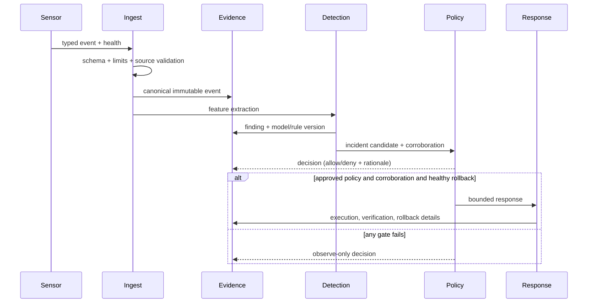

<!-- BEACON COMPUTING INITIATIVE | Developer Seal: CJB-DEV-2026 -->
# ORBIT11 Architecture

**BEACON COMPUTING INITIATIVE** | **Developer Seal: CJB-DEV-2026**  
**ORBIT11 / BCI Orbital Cyber Defense AI** | **Status: Design specification**

## Purpose and boundaries

ORBIT11 is intended as a standalone, local-first cyber-defense stack. It should not require modifying the legacy Orbital installation to function. Integration with another BCI component will be a documented, versioned interface, never an implicit import.

The core separates three planes:

- **Observation plane:** narrowly privileged collectors, normalized event producers and sensor health.
- **Decision plane:** evidence ledger, contextual baselines, deterministic rules, candidate models and correlation.
- **Control plane:** authenticated operator actions, policy publication, notification, enforcement and recovery.

No plane may silently elevate the privileges of another. Containment must never be invoked directly by a model.

## Target components

| Component | Input | Output | Failure behavior |
|:--|:--|:--|:--|
| Identity/context | Host keys, interfaces, route, network namespace | Context key and confidence | Unknown context; conservative defaults |
| Collectors | Authorized kernel/user-space observations | Timestamped typed records | Stop affected sensor, emit health fault |
| Ingest gateway | Source records | Validated canonical events | Reject invalid input; quarantine bad records |
| Evidence ledger | Canonical events and transitions | Hash-chained audit envelopes | Fail closed for any destructive action |
| Baseline store | Approved profiles | Versioned contextual expectations | Unknown/unapproved profile => observe-only |
| Detection engine | Evidence, profile, rules/model | Findings with provenance and uncertainty | Return explicit unavailable/unknown |
| Correlator | Related findings | Bounded incident hypotheses | No causal attribution from coincidence |
| Policy engine | Published policy + incident state | Permit/deny decision with rationale | Deny enforcement on ambiguity |
| Response executor | Authorized action and rollback token | Outcome verification and audit trail | Abort/rollback or escalate |
| Training sandbox | Qualified disposable dataset | Candidate artifact + tests + lineage | Reject candidate; preserve existing model |

## Event contract (proposed v1)

A minimal event envelope shall contain `schema_version`, `event_id`, `host_id`, `boot_id`, `source`, `observed_at_utc`, `monotonic_ns` when available, `network_context_id`, `classification`, `payload_ref`, `collector_version`, `sensitivity`, and `integrity` fields. Unknown values must remain explicitly unknown, never fabricated.

Collectors should emit structured metadata, not freeform conclusions. The ledger stores canonical serialization, previous-entry digest and current entry digest; the ledger design must include sequence gaps, source key rotation and crash recovery. Hashes alone do not establish authenticity or prevent a privileged attacker from rewriting an entire chain: use protected checkpoints, constrained access and optionally signed anchors.

## Data flow

## Processes and permissions

Separate collector processes from reasoning and UI processes. Run without root wherever feasible. An AF_PACKET sensor or privileged socket monitor requires its own explicit installation and capability review. Bind control sockets locally; verify peer identity. The policy engine should accept versioned immutable policy snapshots, not mutable freeform strings.

## Persistence

Proposed stores: write-ahead logged SQLite for transactional state and incident indexes; append-only audit records or content-addressed evidence blobs; a versioned model registry; a retention ledger. Never store secret values in log messages, Git, model training inputs or issue attachments.

Document schema migrations, fsync boundaries, clock anomalies, full-disk behavior, database corruption, chain recovery and restore-from-backup before production qualification.

## Interfaces

Prefer narrow typed event schemas and explicit migrations. Future desktop GUI, notification subsystem, email evidence sender and telemetry exporters must be optional clients. Operators should be able to verify the same incident outcome from the command line without the GUI.

## Trust boundaries and implementation order

Start with synthetic fixtures -> read-only collectors -> evidence verification -> contextual baselines -> deterministic correlation -> training -> operator approvals -> dry-run response -> audited production response. Each boundary requires an independent test suite; see [Testing](TESTING.md).

**Current implementation:** This repo is documentation only. No architecture component above is committed as runnable ORBIT11 code.
