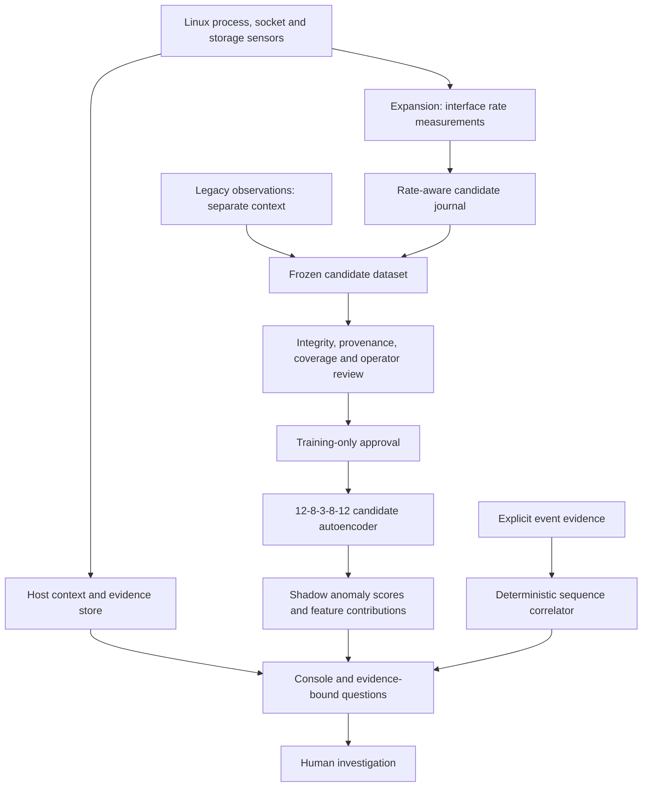

# BCI-Orbit11 architecture

BEACON COMPUTING INITIATIVE · Developer Seal: CJB-DEV-2026

## Data flow

The diagram describes separate command workflows, not an automatically executing
pipeline. A user chooses capture, freeze, review, training and scoring operations.
No diagram edge grants permission to run its destination.

## Component boundaries

### Host monitor

`components/host/src/bci_orbital` contains sensors, a behavioral engine, SQLite
persistence, CLI and a legacy response module. Curated reference rules are labeled
as generic reference data. Observed local behavior and operator-approved profiles
are separate. The test suite verifies that approved profiles do not silently learn
deviations and that changes to event records invalidate chain verification.

This component includes privileged nftables quarantine/release functions. Those
are legacy opt-in response facilities, not outputs automatically authorized by
neural anomaly scores. The repository import neither exercises nor enables them.

### Neural sidecar

`components/neural/src/bci_neural` validates fixed-shape numeric windows, maintains
SHA-256 chained observations, writes create-only snapshots, trains and scores the
autoencoder, and correlates explicit events. Live capture loads a verified installed
host sensor release; merely importing the Python module is not a live capture.
The standalone original capture has unavailable throughput dimensions encoded as
zero plus a coverage gap. Those records must not be silently relabeled as measured.

### Expansion and rate-aware integration

The expansion measures interface RX/TX deltas and records interface/host/route
provenance. The rate-aware runner appends to a separate journal so changes in
measurement semantics do not overwrite historical candidate observations. The
runner's default migration workflow can update the user timer service after typed
approval. Use `--self-test` for development; running it without flags is not a test.

Optional expansion packet and bpftrace commands require explicit privileged opt-in.
They are bounded observations with visibility limits, not a complete wire capture
or comprehensive successful-file-access monitor. Root-owned deployment hardening
is a future operational requirement, not something enabled by this import.

### Console

The console polls component state, reads service diagnostics, shows journal
qualification, and exposes guided operator actions. The GUI uses persistent worker
threads and asynchronous close handling. Missing traffic samples break chart lines
rather than becoming fabricated zero-traffic points. Packet quota HOLD is based on
service state plus a matching journal message, not an assumption about any failure.
The text interface matches supported intents to evidence and verified model reports;
it is not a generative language model.

## Trust classes

| Object | Meaning | Does it authorize response? |
|---|---|---|
| Generic reference rules | Curated rules, not learned host behavior | No |
| `unreviewed_live` window | Observed live candidate telemetry | No |
| `untrusted_legacy` window | Historical telemetry in a separate context | No |
| `synthetic_demo` window | Generated test/demo data | No |
| Training approval | Local review tied to dataset/context | Training only |
| `candidate_unpromoted` model | Experimental checkpoint | No |
| Anomaly score | Reconstruction deviation | No |
| Correlation hypothesis | Linked events satisfying explicit rules | No |
| Host baseline approval | Separate host profile workflow | Not neural promotion |

## Integrity and storage

Source manifests fingerprint shipped files. Runtime candidate journals chain
observations. Frozen datasets and reports have sidecar digests. Host events have a
SQLite event chain. These mechanisms answer consistency questions against retained
hashes; they do not authenticate a hostile sensor or withstand account compromise
without external anchors. Runtime data stays outside the checkout and is excluded
from Git. The repository contains synthetic test/example inputs only.

## Compatibility

Existing launchers, installation paths, model hashes, schema strings and release
versions remain intact. Orbit11 is the repository identity; replacing those identifiers
without migrations would break integrity pins, imports and installed service wiring.
A unified installer, package API and model registry are roadmap items. The current
source tree is an integration baseline with explicit version boundaries.
