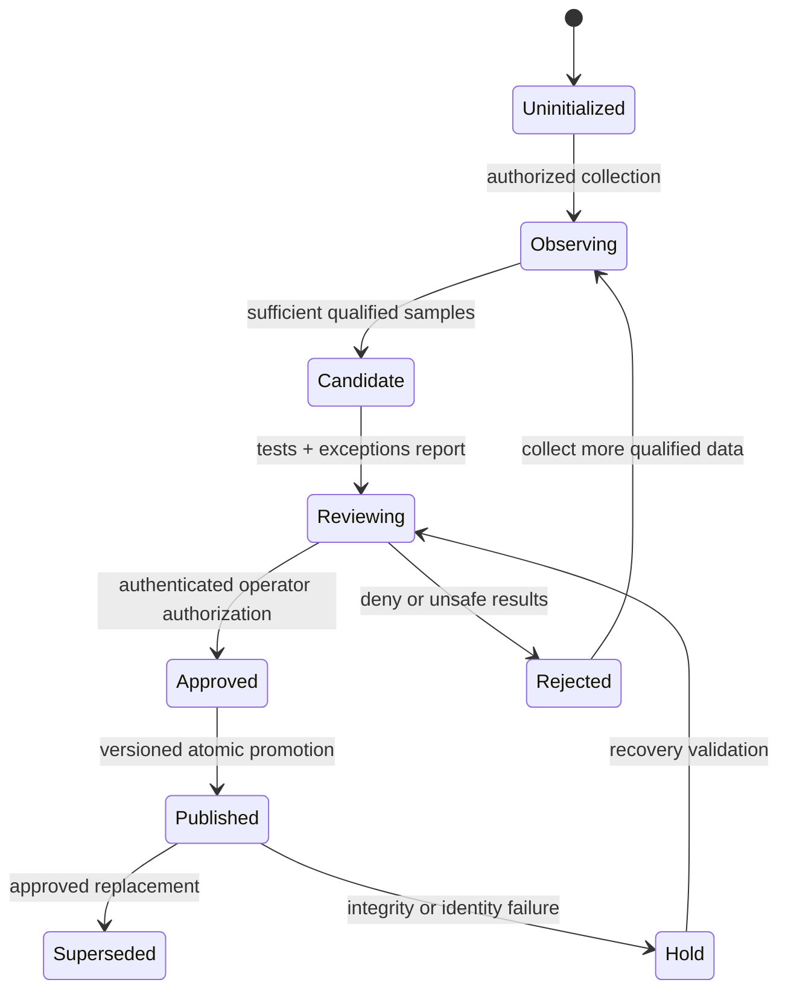

<!-- BEACON COMPUTING INITIATIVE | Developer Seal: CJB-DEV-2026 -->
# Contextual Baselines and Promotion

**BEACON COMPUTING INITIATIVE** | **Developer Seal: CJB-DEV-2026**  
**ORBIT11 / BCI Orbital Cyber Defense AI** | **Status: Design specification**

## Goal

Track legitimate behavior accurately without teaching the system that an attack is normal. A baseline defines the behavior expected for an explicitly identified environment; it is never a universal blanket allow-list.

## Context profile

A proposed profile key includes host identity, network context (approved identifier, route, interface, namespace), operating role, profile version, and collection-quality indicators. Hash or pseudonymize Wi-Fi/network identifiers where needed and protect salts. Unknown or ambiguous context maps to an **unapproved** profile, not the nearest silently promoted one.

Store approved ports/services, process families, outbound destination patterns, storage behavior, distribution summaries, expected update windows, known exceptions, and sensor coverage with confidence.

## Baseline acquisition

A design target is to import up to **30 days of operator-provided historical data**, then observe **7 days of live activity** with an optional **14-day extension**. This is not mandatory elapsed time if data quality is insufficient. History and live events must pass source validation, de-duplication and sensitivity classification.

## State machine

## Publication gate

Publication occurs if and only if the candidate is versioned and reproducible, collection quality meets declared thresholds, safety/negative tests pass, an authorized operator approves the exact content hash, and a rollback target exists. Treat stale approvals or concurrent changes as conflicts requiring a new review.

Do not auto-learn anomalous events into an active baseline. All exceptions need reason, owner, scope and expiry. Maintain an audit trail for profile merges, network-context changes and rejections.

## Drift behavior

Distinguish environment drift from threat evidence. New networks and material OS upgrades trigger proposal/review, not automatic trust. An unknown profile may collect metadata and notify, but never automatically contain under a policy that requires a published profile.

## Review checklist

Review abnormal open ports; outbound shifts; process and service starts; removable-device use; untrusted sample intervals; sensor gaps; data sensitivity; non-production fixtures; known updates; and applicability of existing containment rules.
